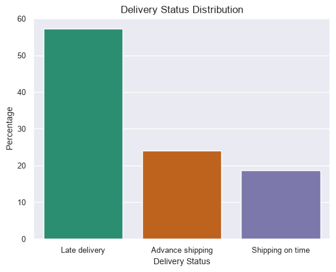
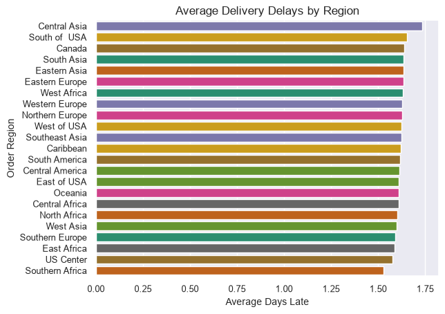
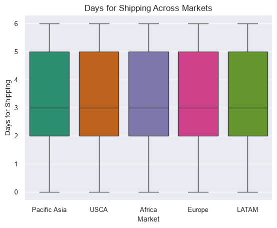
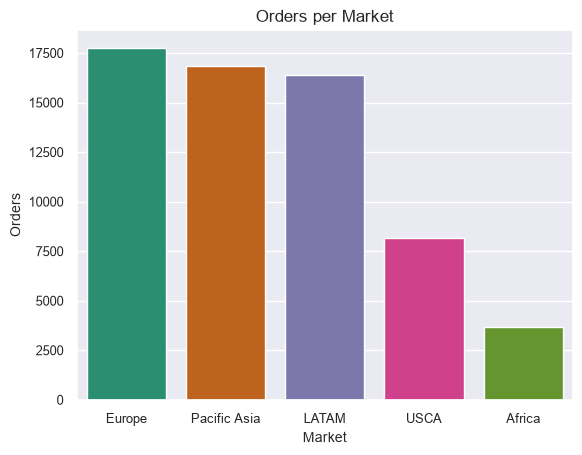
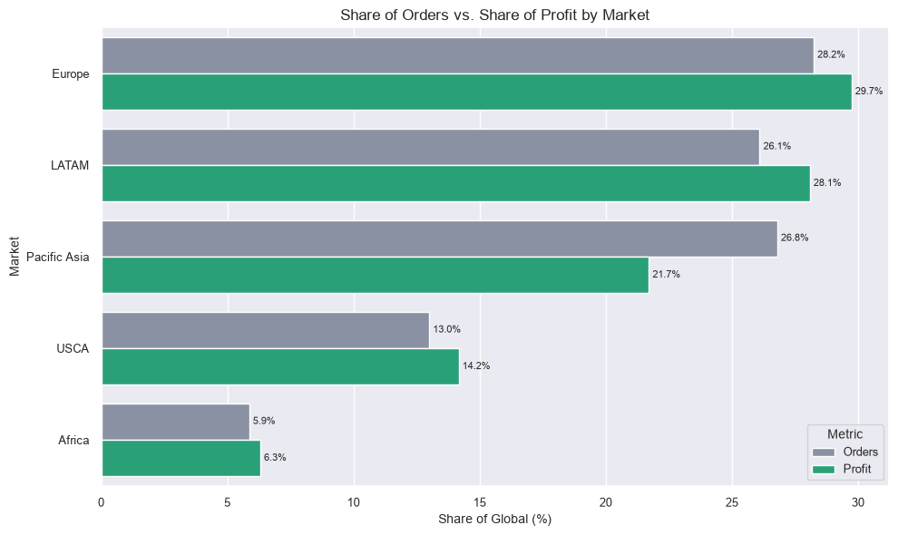
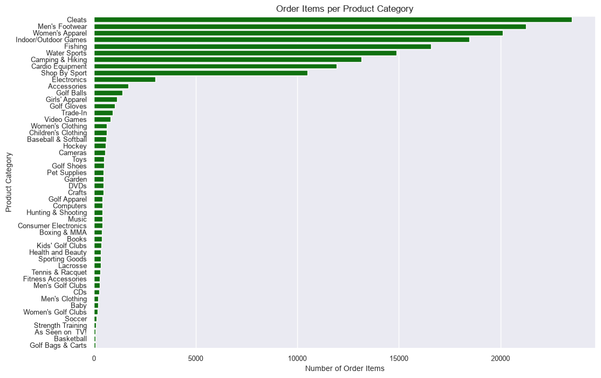
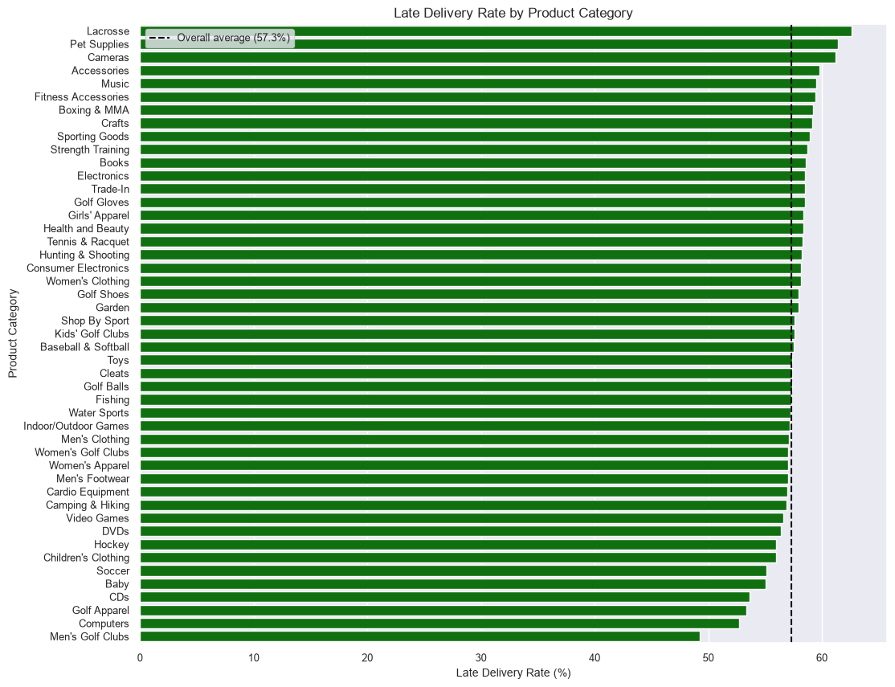
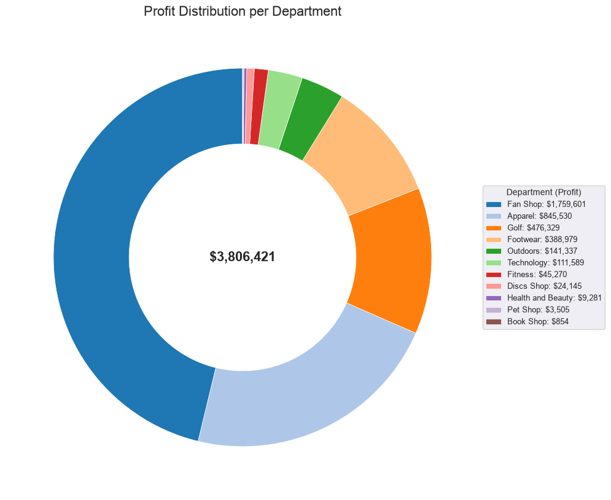
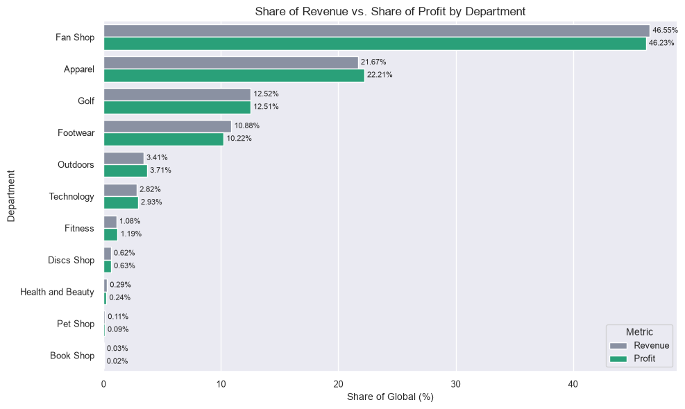

# DataCo Smart Supply Chain Analysis

## 1. Project Overview

This project analyzes supply chain performance using the DataCo Smart Supply Chain dataset. The analysis focuses on identifying operational inefficiencies, evaluating shipping performance, investigating geographical differences, and understanding the relationship between operational performance and profitability.

By examining order fulfillment, shipping modes, geographical markets, product categories, and financial metrics, the project aims to uncover patterns that could help management improve operational efficiency, reduce delivery delays, and increase profitability.

The final objective is to translate data findings into practical business recommendations that support better supply chain decision-making.

## 2. Problem Statement

The company operates across multiple geographical markets, product categories, and shipping modes, creating a complex supply chain that requires effective coordination and management.

However, differences in shipping performance, delivery delays, geographical operations, and profitability may indicate underlying inefficiencies that affect customer satisfaction and business performance.

Without a clear understanding of where these inefficiencies occur and what factors contribute to them, management may struggle to prioritize improvements and allocate resources effectively.

This analysis aims to identify the areas of the supply chain experiencing the greatest operational challenges, investigate potential causes, and determine where operational changes could improve overall business performance and profitability.

## 3. Objectives

1. Identify operational inefficiencies: Determine which areas of the supply chain exhibit the weakest performance and should receive management attention first.
2. Evaluate shipping performance: Compare shipping modes based on delivery delays and fulfillment performance to identify those requiring improvement.
3. Analyze geographical performance: Identify markets and regions experiencing significant operational challenges and investigate potential geographical patterns.
4. Assess profitability: Examine sales, profit, and product performance to identify potential opportunities for improving profitability.
5. Identify improvement opportunities: Translate analytical findings into practical recommendations concerning shipping operations, geographical markets, and resource allocation.
6. Support management decisions: Establish clear, data-driven priorities that can help management improve supply chain efficiency and financial performance.

## 4. Research Questions

- Which areas should management investigate first?
- Which shipping modes require attention?
- Which geographical markets have the biggest operational challenges?
- Are there opportunities to improve profitability?
- What operational changes would you recommend?

## 5. Supporting Investigation Questions

To answer these questions, the analysis will investigate five areas:

### A. Shipping Performance

- What percentage of orders are delivered early, on time, or late?
- Which shipping modes have the highest late-delivery rates?
- Which shipping modes have the greatest average delivery delays?
- Are certain shipping modes consistently less reliable than others?

### B. Geographic Performance

- Which regions experience the highest delivery delay rates?
- Are there geographical markets with consistently longer shipping times?
- Are high-volume markets also experiencing poor shipping performance?
- Which geographical areas should management prioritize?

### C. Product & Department Performance

- Which product categories sell the most units?
- Do certain product categories experience higher delivery delay rates?
- Which departments generate the most revenue and profit?
- Are there departments with high sales but relatively low profitability?

### D. Temporal Trends

- How does order volume change over time?
- Are there seasonal or day-of-week patterns in delivery delays?
- Has shipping performance improved or deteriorated throughout the dataset period?
- Are there particular periods associated with increased operational inefficiencies?

### E. Financial Performance

- Which markets generate the highest sales and profits?
- Which product categories are the most profitable?
- Is there an association between delivery delays and profitability?
- How do discounts affect profit margins?
- Which customer segments contribute most to revenue and profit?

## 6. Data Quality & Preparation

Cleaning steps were decided in the [initial analysis](../notebooks/01-initial-analysis.ipynb). They were executed in [data preparation](../notebooks/02-data-preparation.ipynb)

- 18 columns dropped as they were either identical, 1:1 mappings, empty, constant, mostly missing, or they didn't align with the analysis.
- Rows with cancelled orders were dropped. They were never delivered, but they would've count as "not late", and their sales most likely never happened.
- _order date (DateOrders)_ and _shipping date (DateOrders)_ were converted to dates
- Cleaned whitespace
- Renamed columns
- Standardized column names

**Grain**: In the dataset, each row represents an item, and an order can have 1-5 items. The delivery questions are measured by order, not by item.

## 7. Analysis

### A. Shipping Performance

Source: `notebooks/03-shipping-performance-analysis.ipynb`

#### A1. What percentage of orders are delivered early, on time, or late?

Most orders are delivered late, then early, and the least amount of orders are delivered on time.

- Late delivery: 57.31%
- Advance shipping: 24.05%
- Shipping on time: 18.64%

#### A2. Which shipping modes have the highest late-delivery rates?

First Class has the highest late-delivery rates, then Second Class, third is Same Day delivery, and last being Standard Class.

- First Class: 100.0%
- Second Class: 79.99%
- Same Day: 48.37%
- Standard Class: 39.85%

#### A3. Which shipping modes have the greatest average delivery delays?

For this analysis I went only with the average delivery delays among late orders. Second Class has the greates average delivery delays.

- Second Class: 2.5 days (9803 values)
- Standard Class: 1.5 days (14995 values)
- First Class: 1.0 days (9602 values)
- Same Day: 1.0 days (1648 values)

#### A4. Are certain shipping modes consistently less reliable than others?

Second Class is the least reliable shipping mode. It consistently has a high percentage of late shippments and from Q3 we know that it has the greatest average delivery delay.

### B. Geographic Performance

Source: `notebooks/04-geographic-performance-analysis.ipynb`

#### B1. Which regions experience the highest delivery delay rates?

The variability is low in delivery delay rates. The highest average delivery delay is 1.74 days, and the lowest is 1.53 days.

- Central Asia: 1.74 days (102 values)
- South of USA: 1.65 days (753 values)
- Canada: 1.64 days (153 values)
- South Asia: 1.64 days (1865 values)
- Eastern Asia: 1.63 days (1818 values)

It's worth noting that Central Asia has the least amount of orders, therefore the data might be noisy.

#### B2. Are there geographical markets with consistently longer shipping times?

While investigating consistency in longer shipping times across different markets, the results that I got strongly suggest that the data is synthetic. Orders are divided into batches between markets, and only January 2017 has orders from all 5 markets at once. Therefore comparison of markets over time is **NOT** possible.

For this reason, I took a different approach. Instead of comparing over time, I compared days for shipping across markets.

The result that I got is quite interesting, and is another supporter of synthetic data. The data suggests that there is no difference in days for shipping across different markets. Below is the average days for shipping across markets:

- Africa - 3.496612
- Europe - 3.496650
- LATAM - 3.500670
- Pacific Asia - 3.511007
- USCA - 3.496454

The difference in average days for shipping across markets is: 0.015 days.

#### B3. Are high-volume markets also experiencing poor shipping performance?

For this question I used two methods: late delivery risk per market and average days for shipping per market.

Europe is the highest volume market (17763 orders), Africa the lowest (3689 orders).

Late delivery risk indicates if sending is late or not, and it's almost identical between markets:

- Late delivery risk in Pacific Asia: 57.68%
- Late delivery risk in USCA: 57.52%
- Late delivery risk in Europe: 57.42%
- Late delivery risk in LATAM: 56.9%
- Late delivery risk in Africa: 56.55%

We already saw in Q2 that days for shipping per markets are almost identical, which suggests that shipping performance doesn't depend on the volume of a market.

#### B4. Which geographical areas should management prioritize?

Q1, Q2 and Q3 all answer questions about shipping and delivery in different markets/regions. For this question I wanted to explore more of the business weight: sales and profit in different markets.

For this question I also calculated profit and sales for all items, not just per order.

1. **Protect** Europe and LATAM. They bring the majority of the profit, so service problems there would cost the most.
2. **Grow basket size** in Pacific Asia.
3. **Lower priority** USCA and Africa. Their profit per order is good, but their volumes are smaller.
4. **Bonus**: **Fix late deliveries globally**.

### C. Product & Department Performance

Source: `notebooks/05-product-and-department-analysis.ipynb`

#### C1. Which product categories sell the most units?

Answering this question was pretty straightforward - I grouped number of order items by product category. Besides getting just the raw number, to better understand the distribution, I also calculated the share of global sales per product category. Here are the results:

1. Cleats: 23,514 items (13.61%)
2. Men's Footwear: 21,263 (12.31%)
3. Women's Apparel: 20,116 (11.64%)
4. Indoor/Outdoor Games: 18,470 (10.69%)
5. Fishing: 16,595 (9.61%)

#### C2. Do certain product categories experience higher delivery delay rates?

To answer this question, I analysed two things:

- I took the late delivery risk mean of each product category and compared it to the overall average
- I looked at the average delivery delay in days for each product category

The average late delivery risk of each category compared to the overall average suggested that there aren't any product categories that experience higher delivery delay rates. All categories being at most +5% and -8% away from the overall average.

The average delivery delay in days showed similar results. The category with lowest delivery delay in days and the category with highest delivery delay in days have a difference of just 0.26 days on average.

**With these two results, I am confident that there are no patterns in delivery delay rates for certain product categories.**

#### C3. Which departments generate the most revenue and profit?

Answering this question was also straightforward, with very clear results. I calculated the profit and revenue by department:

1. **Fan Shop:** Profit: $1,759,601; Revenue: $14,730,174
2. **Apparel:** Profit: $845,530; Revenue: $6,858,959
3. **Golf:** Profit: $476,329; Revenue: $3,962,014
4. **Footwear:** Profit: $388,979; Revenue: $3,443,987
5. **Outdoors:** Profit: $141,337; Revenue: $1,078,728

The results for both profit and revenue align well for all departments. Which build directly on the last question.

#### C4. Are there departments with high sales but relatively low profitability?

Having the answer to C3 in mind, there are no departments with high sales but low profitability. To make the answer clearer, I calculated the share of profit and revenue for each department.

The highest difference in share of revenue and share of profit is in the Footwear department - 10.22% profit share; 10.88% revenue share; 0.66 percentage points difference.

### D. Temporal Trends

#### D1. How does order volume change over time?

#### D2. Are there seasonal or day-of-week patterns in delivery delays?

#### D3. Has shipping performance improved or deteriorated throughout the dataset period?

#### D4. Are there particular periods associated with increased operational inefficiencies?

### E. Financial Performance

#### E1. Which markets generate the highest sales and profits?

#### E2. Which product categories are the most profitable?

#### E3. Is there an association between delivery delays and profitability?

#### E4. How do discounts affect profit margins?

#### E5. Which customer segments contribute most to revenue and profit?

## 8. Conclusions

<!-- Answer the five research questions from section 4, drawing on the subsections above.
Refer back to them (e.g. "see A2, A4") instead of repeating the numbers. -->

### 8.1 Which areas should management investigate first?

Management should focus on minimizing delivery delays. Late delivery risk is similar between different markets (~57%), suggesting that it's not an issue of markets, but an issue of delivery.

Management should also investigate why Pacific Asia has fewer items per order than other markets. Bundle promotions could be one way to boost more items per order.

### 8.2 Which shipping modes require attention?

Second Class is probably the shipping mode that requires most attention. In A2, A3 and A4 we discovered that it is the least reliable shipping mode and has the highest average delivery delay.

The lateness in First Class is probably an issue rather than real lateness, since it's always 1 day late and at 100% late shipment rate, 36 months in a row.

### 8.3 Which geographical markets have the biggest operational challenges?

All markets suffer from the same operational challenge - late deliveries. In B3 we found that all markets have a similar percentage of late delivery risk (around 57%), no matter how big or small the volume of orders is.

The market that management should prioritize is Pacific Asia. Orders contain fewer items than in other markets, and average items per order is directly tied to average profit per order.

Europe and LATAM bring the majority of the profit, therefore protecting those markets is crucial.

### 8.4 Are there opportunities to improve profitability?

### 8.5 What operational changes would you recommend?

## 9. Limitations

- Likely synthetic data.
- Delays are recorded in whole days, instead of hours for example.
- 'Same Day' shipping mode is a small group and causes noise.
