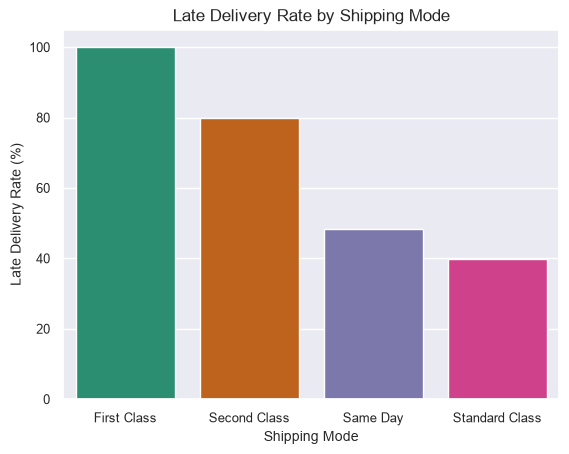
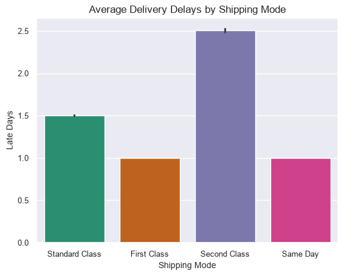
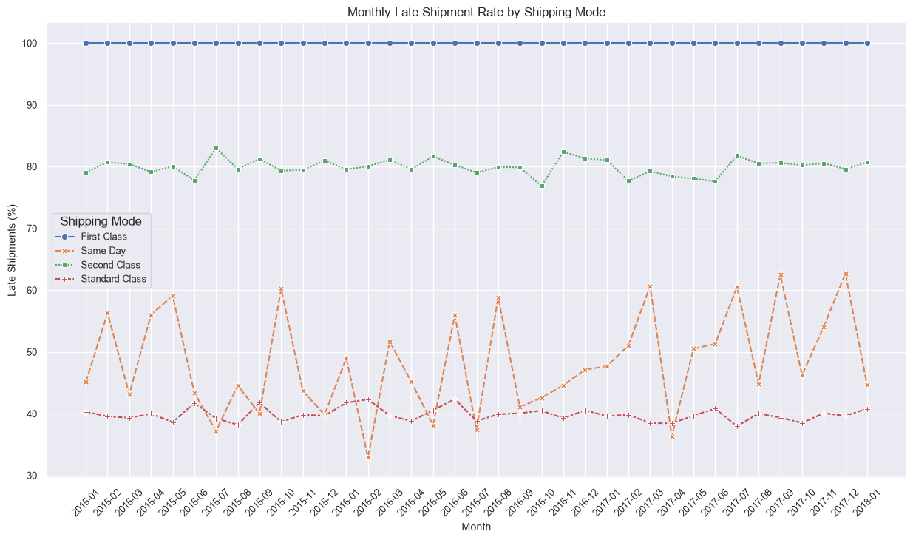

# DataCo Smart Supply Chain Analysis

## 1. Project Overview

This project analyzes supply chain performance using the DataCo Smart Supply Chain dataset. The analysis focuses on identifying operational inefficiencies, evaluating shipping performance, investigating geographical differences, and understanding the relationship between operational performance and profitability.

By examining order fulfillment, shipping modes, geographical markets, product categories, and financial metrics, the project aims to uncover patterns that could help management improve operational efficiency, reduce delivery delays, and increase profitability.

The final objective is to translate data findings into practical business recommendations that support better supply chain decision-making.

## 2. Problem Statement

The company operates across multiple geographical markets, product categories, and shipping modes, creating a complex supply chain that requires effective coordination and management.

However, differences in shipping performance, delivery delays, geographical operations, and profitability may indicate underlying inefficiencies that affect customer satisfaction and business performance.

Without a clear understanding of where these inefficiencies occur and what factors contribute to them, management may struggle to prioritize improvements and allocate resources effectively.

This analysis aims to identify the areas of the supply chain experiencing the greatest operational challenges, investigate potential causes, and determine where operational changes could improve overall business performance and profitability.

## 3. Objectives

1. Identify operational inefficiencies: Determine which areas of the supply chain exhibit the weakest performance and should receive management attention first.
2. Evaluate shipping performance: Compare shipping modes based on delivery delays and fulfillment performance to identify those requiring improvement.
3. Analyze geographical performance: Identify markets and regions experiencing significant operational challenges and investigate potential geographical patterns.
4. Assess profitability: Examine sales, profit, and product performance to identify potential opportunities for improving profitability.
5. Identify improvement opportunities: Translate analytical findings into practical recommendations concerning shipping operations, geographical markets, and resource allocation.
6. Support management decisions: Establish clear, data-driven priorities that can help management improve supply chain efficiency and financial performance.

## 4. Research Questions

- Which areas should management investigate first?
- Which shipping modes require attention?
- Which geographical markets have the biggest operational challenges?
- Are there opportunities to improve profitability?
- What operational changes would you recommend?

## 5. Supporting Investigation Questions

To answer these questions, the analysis will investigate five areas:

### A. Shipping Performance

- What percentage of orders are delivered early, on time, or late?
- Which shipping modes have the highest late-delivery rates?
- Which shipping modes have the greatest average delivery delays?
- Are certain shipping modes consistently less reliable than others?

### B. Geographic Performance

- Which markets, countries, or regions experience the highest delivery delay rates?
- Are there geographical markets with consistently longer shipping times?
- Are high-volume markets also experiencing poor shipping performance?
- Which geographical areas should management prioritize?

### C. Product & Department Performance

- Which product categories generate the highest order volumes?
- Do certain product categories experience higher delivery delay rates?
- Which departments generate the most revenue and profit?
- Are there departments with high sales but relatively low profitability?

### D. Temporal Trends

- How does order volume change over time?
- Are there seasonal or day-of-week patterns in delivery delays?
- Has shipping performance improved or deteriorated throughout the dataset period?
- Are there particular periods associated with increased operational inefficiencies?

### E. Financial Performance

- Which markets generate the highest sales and profits?
- Which product categories are the most profitable?
- Is there an association between delivery delays and profitability?
- How do discounts affect profit margins?
- Which customer segments contribute most to revenue and profit?

## 6. Data Quality & Preparation

Cleaning steps were decided in the [initial analysis](../notebooks/01-initial-analysis.ipynb). They were executed in [data preparation](../notebooks/02-data-preparation.ipynb)

- 18 columns dropped as they were either identical, 1:1 mappings, empty, constant, mostly missing, or they didn't align with the analysis.
- Rows with cancelled orders were dropped. They were never delivered, but they would've count as "not late", and their sales most likely never happened.
- _order date (DateOrders)_ and _shipping date (DateOrders)_ were converted to dates
- Cleaned whitespace
- Renamed columns
- Standardized column names

**Grain**: In the dataset, each row represents an item, and an order can have 1-5 items. The delivery questions are measured by order, not by item.

## 7. Analysis

### A. Shipping Performance

Source: `notebooks/03-shipping-performance-analysis.ipynb`

#### A1. What percentage of orders are delivered early, on time, or late?

Most orders are delivered late, then early, and the least amount of orders are delivered on time.

- Late delivery: 57.31%
- Advance shipping: 24.05%
- Shipping on time: 18.64%

#### A2. Which shipping modes have the highest late-delivery rates?

First Class has the highest late-delivery rates, then Second Class, third is Same Day delivery, and last being Standard Class.

- First Class: 100.0%
- Second Class: 79.99%
- Same Day: 48.37%
- Standard Class: 39.85%

#### A3. Which shipping modes have the greatest average delivery delays?

For this analysis I went only with the average delivery delays among late orders. Second Class has the greates average delivery delays.

- Second Class: 2.5 days (9803 values)
- Standard Class: 1.5 days (14995 values)
- First Class: 1.0 days (9602 values)
- Same Day: 1.0 days (1648 values)

#### A4. Are certain shipping modes consistently less reliable than others?

Second Class is the least reliable shipping mode. It consistently has a high percentage of late shippments and from Q3 we know that it has the greatest average delivery delay.

### B. Geographic Performance

#### B1. Which markets, countries, or regions experience the highest delivery delay rates?

#### B2. Are there geographical markets with consistently longer shipping times?

#### B3. Are high-volume markets also experiencing poor shipping performance?

#### B4. Which geographical areas should management prioritize?

### C. Product & Department Performance

#### C1. Which product categories generate the highest order volumes?

#### C2. Do certain product categories experience higher delivery delay rates?

#### C3. Which departments generate the most revenue and profit?

#### C4. Are there departments with high sales but relatively low profitability?

### D. Temporal Trends

#### D1. How does order volume change over time?

#### D2. Are there seasonal or day-of-week patterns in delivery delays?

#### D3. Has shipping performance improved or deteriorated throughout the dataset period?

#### D4. Are there particular periods associated with increased operational inefficiencies?

### E. Financial Performance

#### E1. Which markets generate the highest sales and profits?

#### E2. Which product categories are the most profitable?

#### E3. Is there an association between delivery delays and profitability?

#### E4. How do discounts affect profit margins?

#### E5. Which customer segments contribute most to revenue and profit?

## 8. Conclusions

<!-- Answer the five research questions from section 4, drawing on the subsections above.
Refer back to them (e.g. "see A2, A4") instead of repeating the numbers. -->

### 8.1 Which areas should management investigate first?

### 8.2 Which shipping modes require attention?

Second Class is probably the shipping mode that requires most attention. In A2, A3 and A4 we discovered that it is the least reliable shipping mode and has the highest average delivery delay.

The lateness in First Class is probably an issue rather than real lateness, since it's always 1 day late and at 100% late shipment rate, 36 months in a row.

### 8.3 Which geographical markets have the biggest operational challenges?

### 8.4 Are there opportunities to improve profitability?

### 8.5 What operational changes would you recommend?

## 9. Limitations

- Likely synthetic data.
- Delays are recorded in whole days, instead of hours for example.
- 'Same Day' shipping mode is a small group and causes noise.
